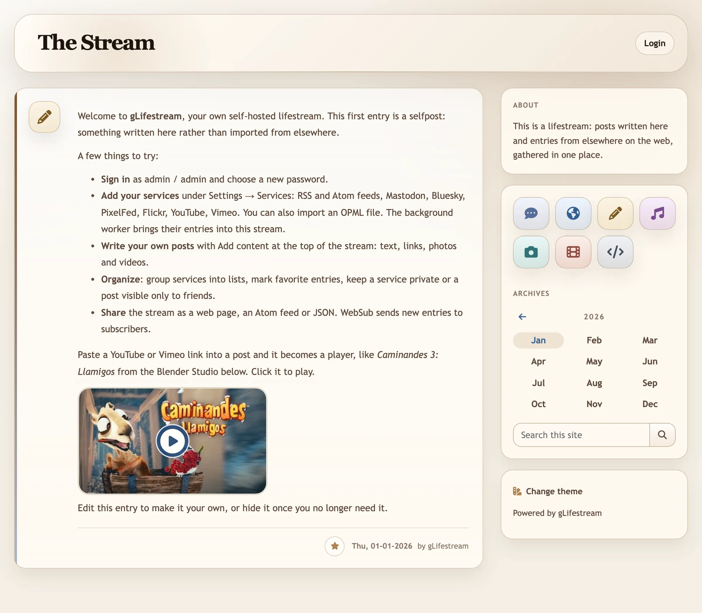
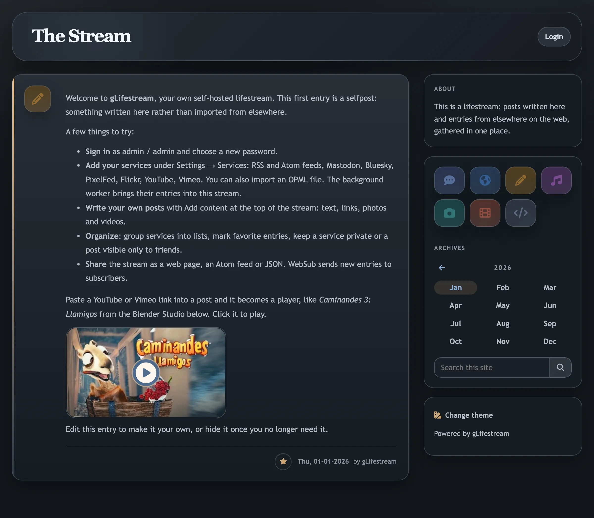
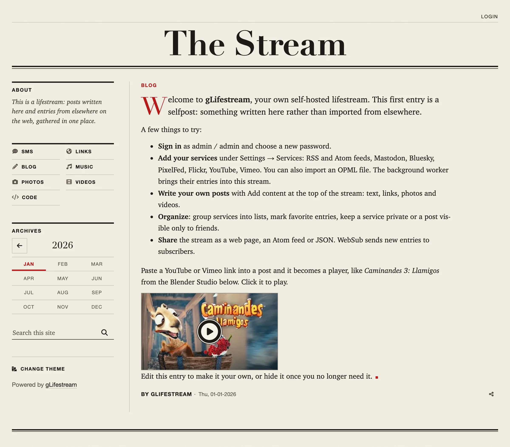
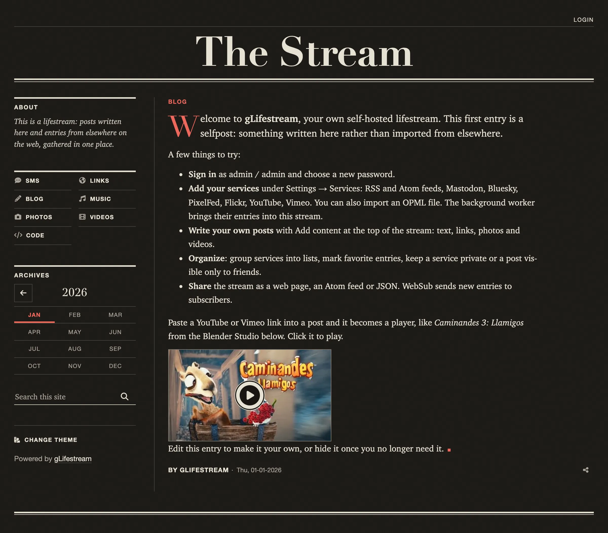
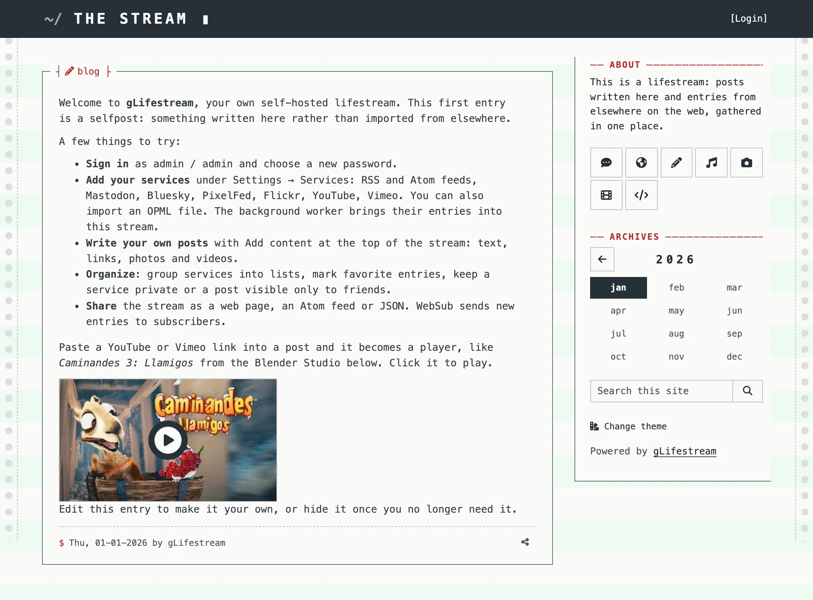
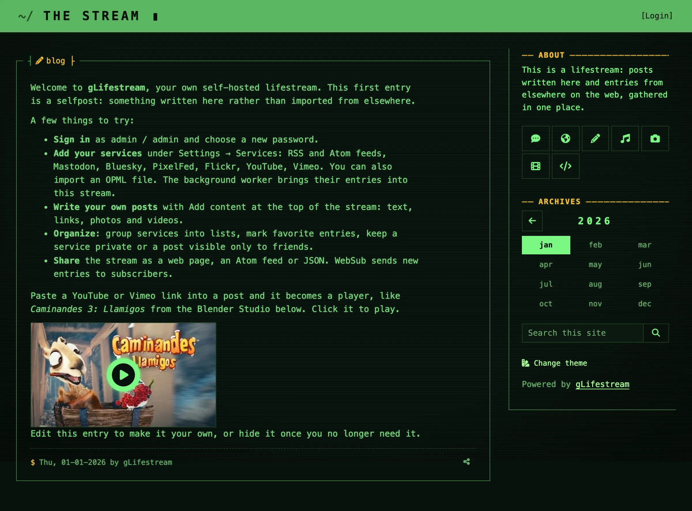
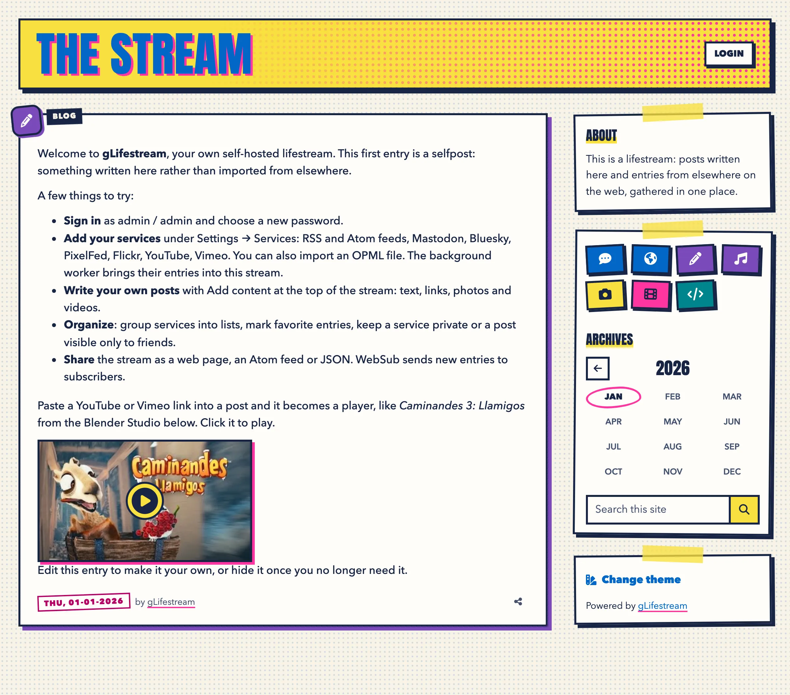
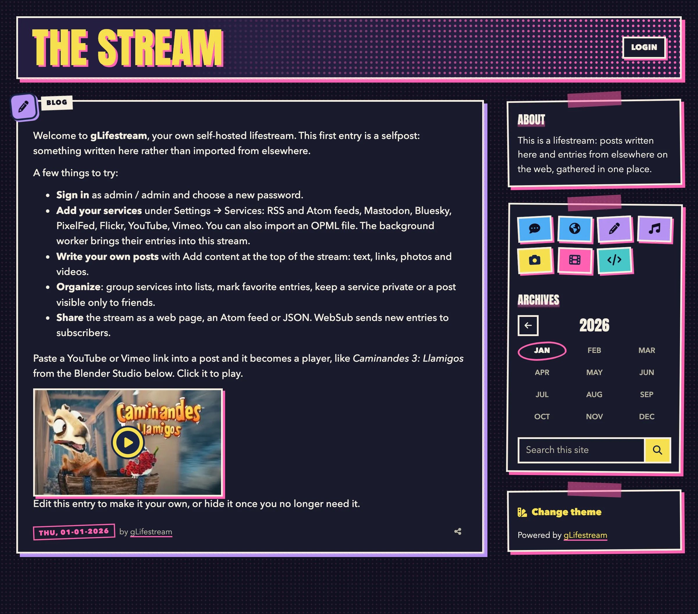
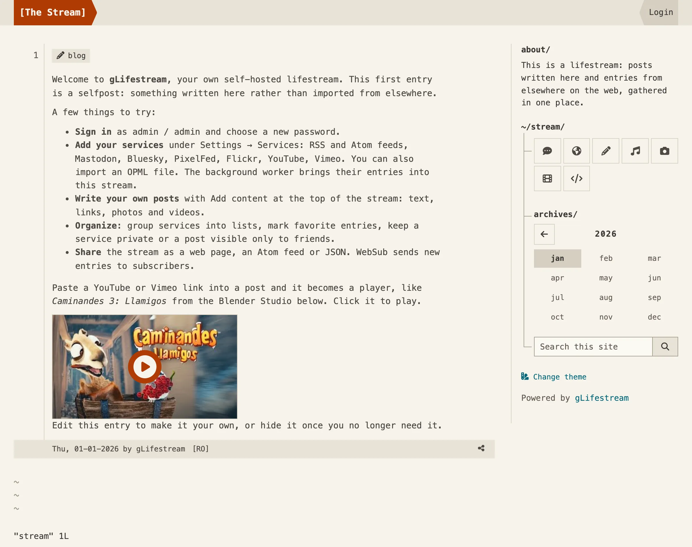
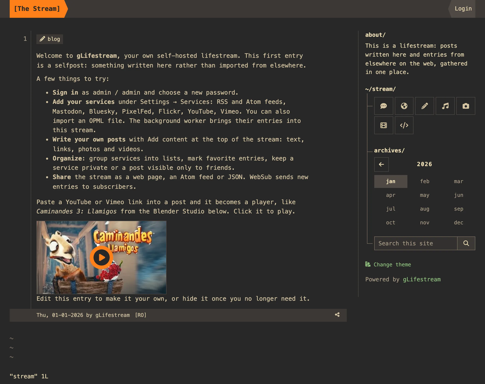

# Themes

gLifestream ships five themes, each following the system's light or dark
mode. A visitor switches between the themes a site offers with "Change theme"
in the sidebar. Which themes are offered, which one a visitor starts with,
and how to make a theme of your own are described in
[INSTALL.md](../INSTALL.md#themes).

## default

| Light | Dark |
| --- | --- |
|  |  |

## broadsheet

The front page of a daily: a didone nameplate, an index of the sections on
the left, the stories in serifs. Light is newsprint; dark is the night edition.

| Light | Dark |
| --- | --- |
|  |  |

## phosphor

A terminal. Dark is a green CRT with glowing type and scanlines; light is the
same stream off a line printer, on green-bar paper.

| Light | Dark |
| --- | --- |
|  |  |

## riso

A risograph-printed zine: a few flat inks on cream paper, a halftone screen,
thick borders and hard shadows. Dark prints the same inks on black paper.

| Light | Dark |
| --- | --- |
|  |  |

## dotfiles

A riced terminal: tmux's status line on top, the entries as vim buffers, the
sidebar as a file tree, in a warm, retro palette after gruvbox.

| Light | Dark |
| --- | --- |
|  |  |
